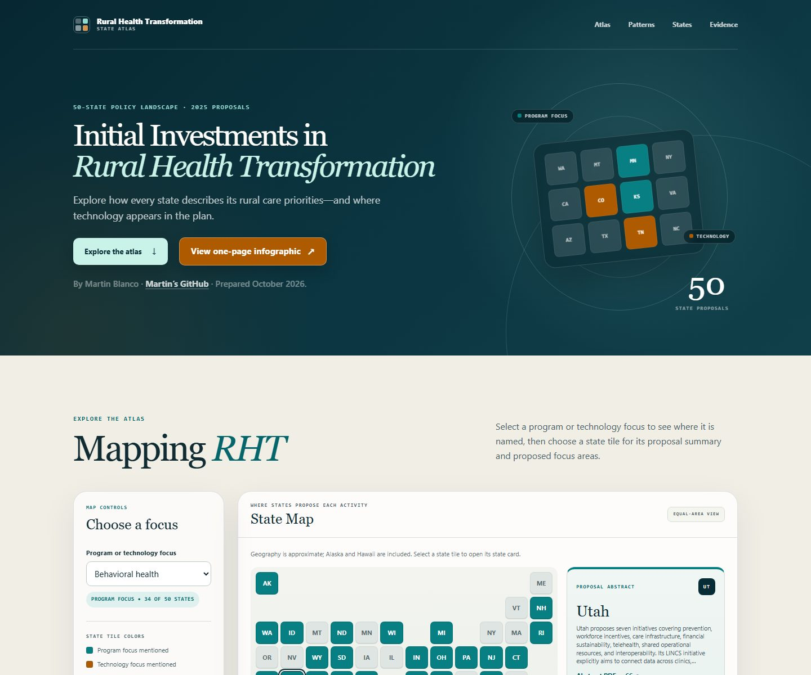
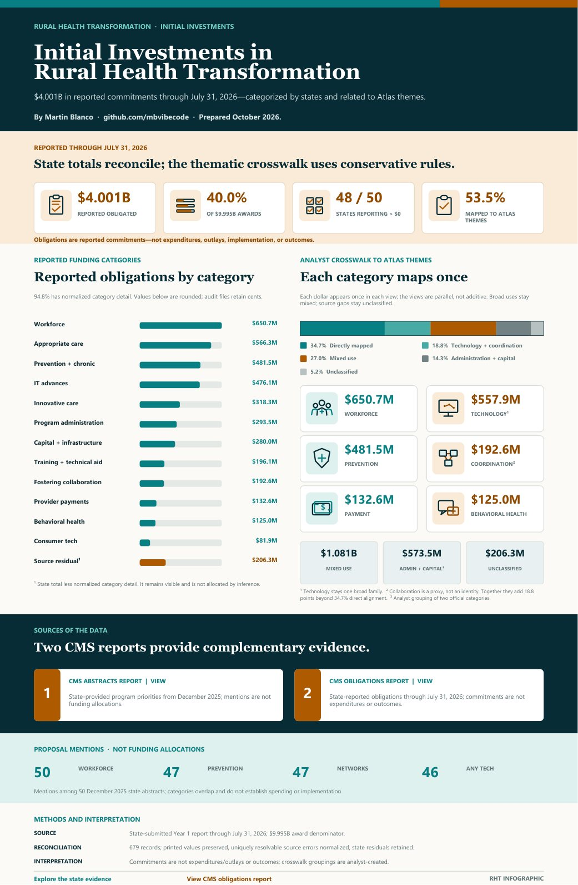

# Initial Investments in Rural Health Transformation

[**Open the live 50-state atlas →**](https://mbvibecode.github.io/rht-state-atlas/)

An interactive, source-transparent review of how every state proposed using the Rural Health Transformation Program and what states reported as initially obligated through July 31, 2026.

Coding review and adjudication were completed October 14, 2026. The original 373-row positive queue confirmed 372 classifications and rejected one false positive: generic patient-facing technology in New Hampshire was not treated as evidence of a consumer device or wearable. A supplemental review of classifications omitted by that positive-only queue confirmed 35 false negatives from explicit positive-dollar obligation evidence. The final inventory contains 407 obligation-positive classifications, all covered by the published adjudication trail.

## Explore the atlas

The State Map is intentionally proposal-focused. Teal capsules identify proposed program areas, orange capsules identify proposed technology areas, and gray means the selected area was not named in the abbreviated state abstract.

## View the leadership infographic

[**Open the full-resolution one-page infographic →**](RHT_50_State_Leadership_Report.pdf)

## What we did

This project turns two lengthy CMS reports into a consistent 50-state evidence package. We:

1. Reviewed the December 2025 state-provided project abstracts for all 50 states.
2. Coded 12 recurring program and technology focus areas, plus eight specific technology groups.
3. Built an interactive state atlas with an equal-area map, state summaries, comparison charts, matrices, and downloadable evidence.
4. Parsed and reconciled 679 reported obligation records totaling **$4.001 billion** through July 31, 2026.
5. Compared proposal themes with explicit obligation categories, initiatives, and line items while keeping the two evidence sources separate.
6. Created a reviewable Excel inventory, CSV data, presentation heat maps, and a one-page leadership infographic.

## Project at a glance

| Measure | Result |
|---|---:|
| States reviewed | 50 |
| Proposal focus areas | 12 |
| Named technology groups | 8 |
| Reported obligation records reviewed | 679 |
| Reported obligations through July 31, 2026 | $4.001B |
| States reporting positive obligations | 48 of 50 |
| Share of the $9.995B award total reported as obligated | 40.0% |

## How to read the proposal–obligation comparison

The source-reconciliation work uses four simple labels:

- **P+O:** the area is named in the proposal abstract and supported by explicit obligation evidence.
- **P:** the area is proposed but not explicitly named in the July 31 obligations snapshot.
- **O:** explicit obligation evidence is present, but the area is not named in the abbreviated abstract.
- **—:** the area was not explicitly located in either supplied report.

A **P-only** result is not a contradiction and does not mean the activity was cancelled. The obligations report captures an early phase of the program. An obligation is also not the same as an expenditure, delivered service, implementation milestone, or outcome.

Broad categories such as `IT Advances` and `Consumer Tech Solutions` are not used to infer AI, cybersecurity, telehealth, EHR, or another technology subtype unless the initiative or line-item language supports that interpretation.

In the website matrix, hover, keyboard-focus, or tap any **P+O** or **O** cell to see its reported amount, a short example of the reported work, and the source page. A dollar figure is shown only when the report provides a matching official-category total; otherwise the tooltip says that no focus-specific total was separately itemized. Category totals can appear in more than one thematic cell and should not be added together.

The State Evidence Digest focus filter uses that same reconciliation record as the matrix. Selecting a focus includes every state marked **P**, **O**, or **P+O**, and each resulting card displays its selected-focus status and any obligations-report source page. The search box further narrows those results and searches state names, proposal summaries, reviewed obligation notes, and positive reconciliation evidence.

## Main public files

- [Interactive website](index.html)
- [One-page leadership infographic](RHT_50_State_Leadership_Report.pdf)
- [Presentation and heat-map package](RHT_Heat_Map_MB.pdf)
- [Excel evidence inventory](RHT_50_State_Inventory.xlsx)
- [50-state proposal coding and financial context](RHT_50_State_Data.csv)
- [Build manifest and SHA-256 provenance](RHT_Build_Manifest.json)
- [Independent coding adjudication](RHT_Coding_Adjudication.csv)
- [Coding-review summary](RHT_Coding_Adjudication_Summary.csv)

## Public source reports

- [CMS state-provided project abstracts, December 2025](rht-program-state-provided-abstracts.pdf)
- [CMS reported obligated funds through July 31, 2026](RHTP-Obligated-Funds-10082026.pdf)

## Method in brief

Proposal classifications are analyst-curated from the state abstract compilation. General needs or possible recipients alone do not qualify as a proposed activity. Obligation evidence requires a positive-dollar official category or explicit initiative or line-item description. Zero-dollar initiatives are excluded.

Care-area and technology linkage uses a stricter rule: the care area and named technology must appear in the same positive-dollar line-item/category segment, or a care-specific initiative title must govern the technology line item. State-level, page-level, or broad-initiative co-occurrence alone does not qualify.

The project is descriptive and is not an official CMS rating, funding determination, or assessment of state performance.

The state obligation notes are maintained as the controlled reviewed input `inputs/RHT_State_Obligation_Notes.csv`. The obligation analysis validates its schema and one-row-per-state coverage before publishing it to the deliverable and website packages.

The review trail is maintained in `inputs/RHT_Coding_Adjudication.csv`, embedded in the Excel inventory, and published as a source-separated download. It contains both the original positive-queue review and the supplemental negative-gap corrections. The build fails if the current set of obligation-positive theme, named-technology, and care-area-linkage classifications does not exactly match the final positive adjudications.

## Static-site deployment

The published entry point is `index.html`. The site is self-contained and does not require external scripts, fonts, maps, or analytics. To redeploy, rebuild and review the source package, synchronize the public website files, test locally, and commit and push the updated package to the `main` branch used by GitHub Pages.
